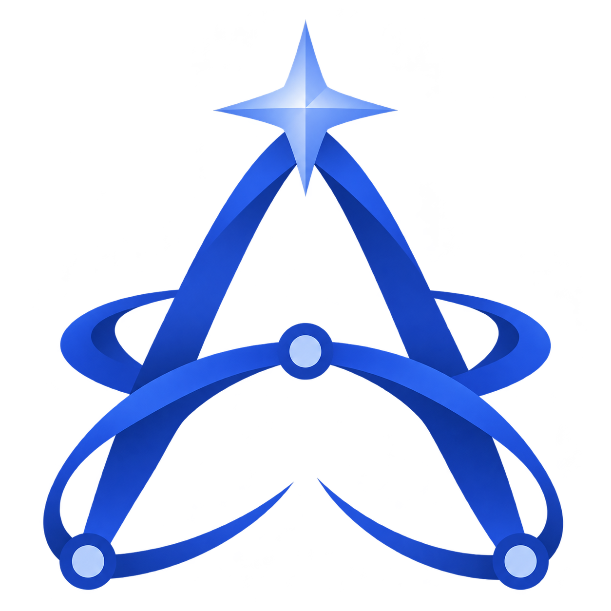
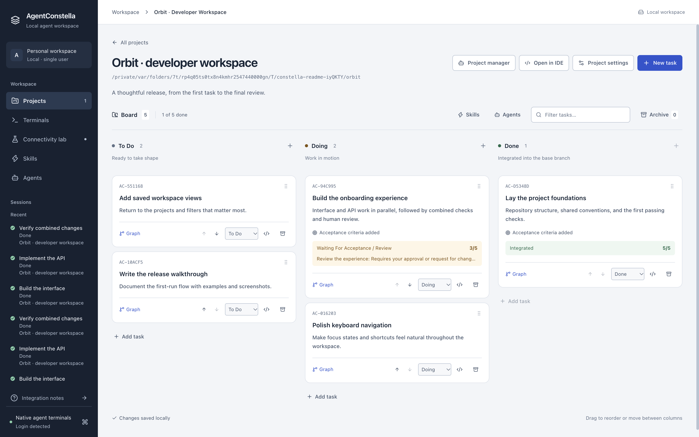
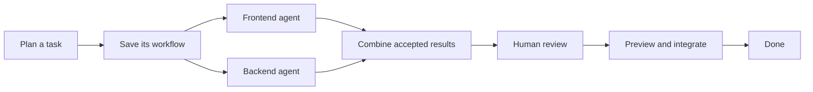
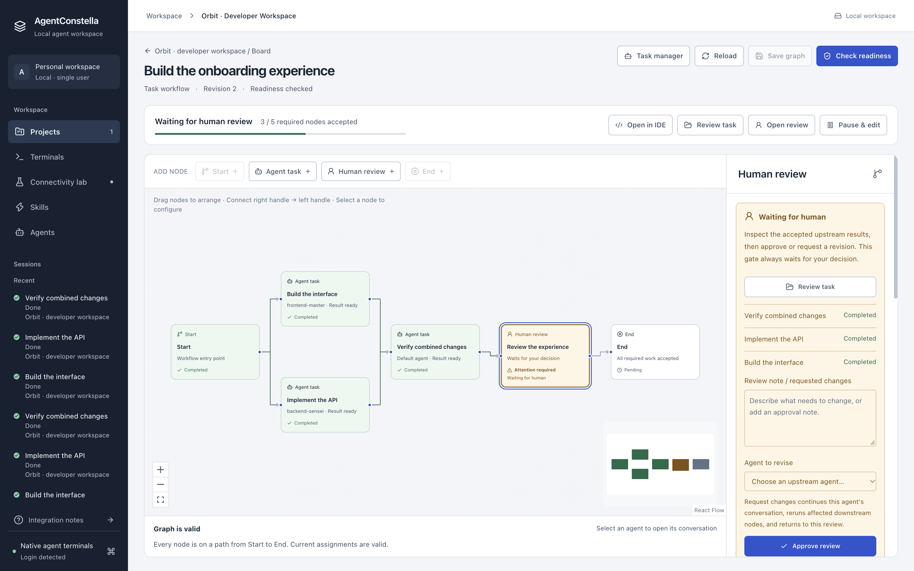
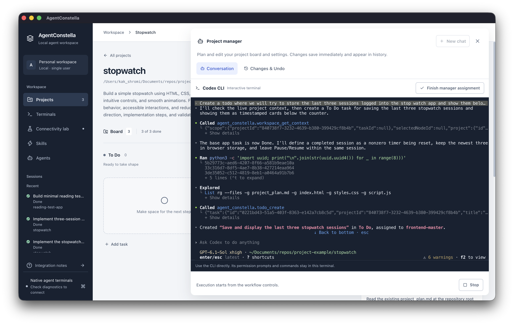
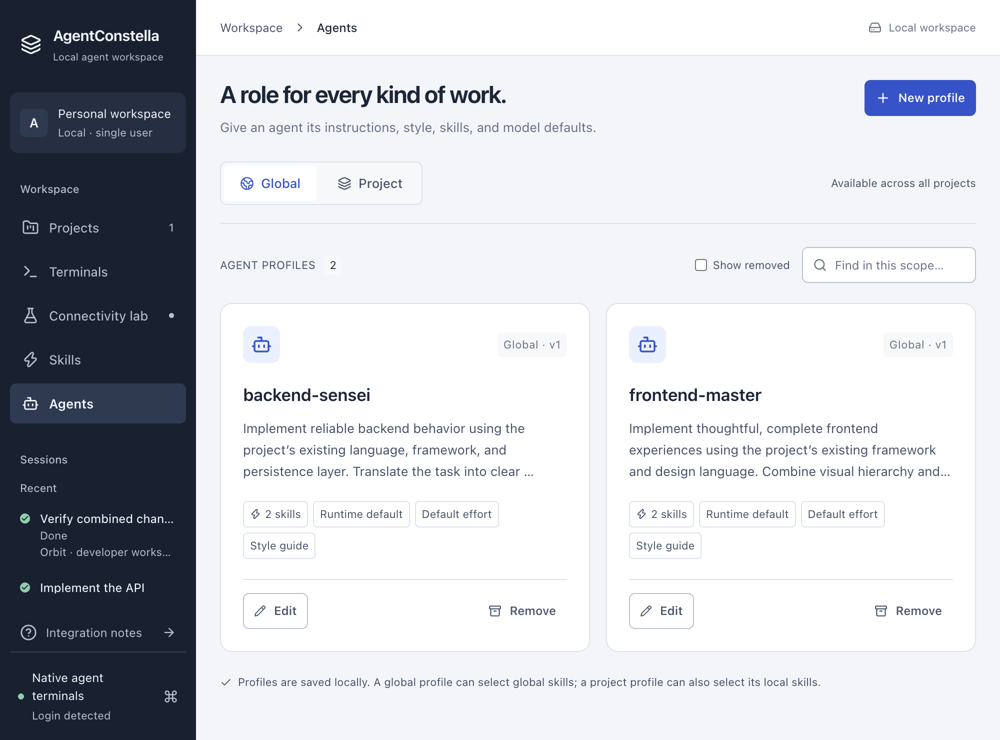
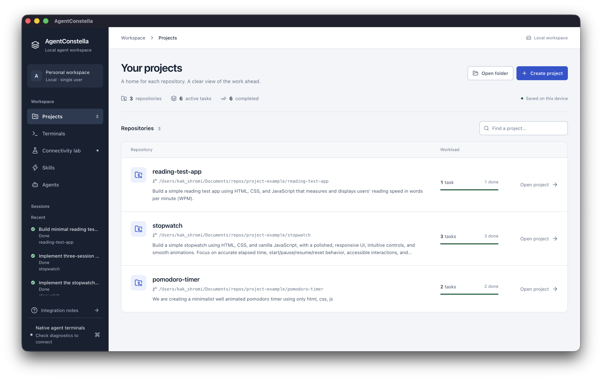
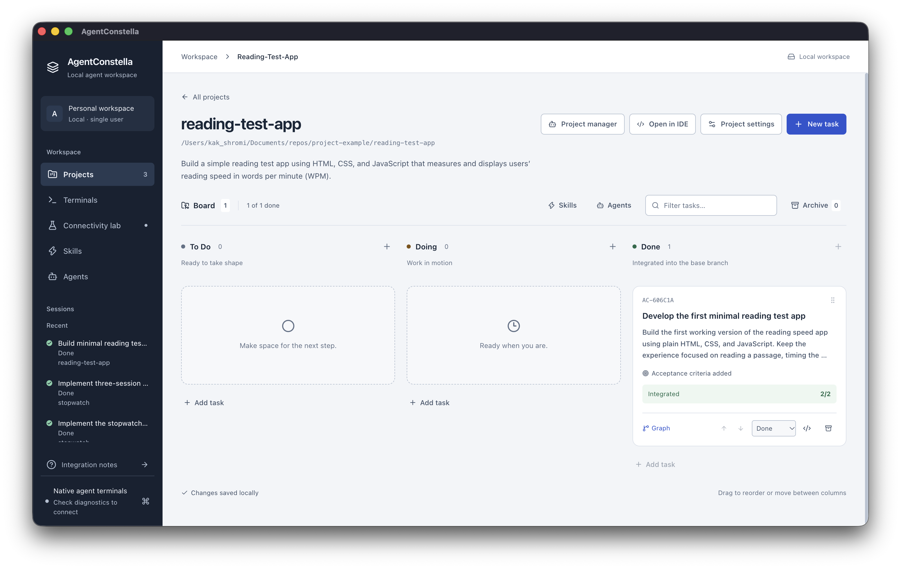

<div align="center">



# AgentConstella

### Your agents. One constellation.

A local desktop workspace for turning repository tasks into<br />
coordinated agent workflows, reviewed code, and integrated branches.

<p>
  
  
  
  
</p>

<p>
  <a href="#quick-start">Quick start</a> ·
  <a href="#from-task-to-integrated-code">The workflow</a> ·
  <a href="#inside-the-workspace">Screenshots</a> ·
  <a href="#documentation">Documentation</a>
</p>

</div>

[](docs/assets/screenshots/project-board.png)

<p align="center"><sub>The real desktop interface, shown with a disposable demo project. Click any screenshot to inspect it at full size.</sub></p>

## Give agent work a place to come together

Coding with several agents means keeping track of more than prompts: which task depends on which, where each agent is working, what passed its checks, and what is ready to merge.

**AgentConstella brings that work into one desktop workspace.** Organize a repository on a Kanban board, draw its task workflows, and run your installed Codex CLI or Claude Code in native terminals. Each coding node gets its own Git branch and worktree. Review the combined result, request changes, and explicitly integrate it into your base branch.

Built for an individual developer coordinating human and agent work across local repositories.

| Capability | What it gives you |
| --- | --- |
| **A board for every repository** | Persistent tasks, acceptance criteria, drag-and-drop ordering, archives, and project settings. |
| **Visual task workflows** | Connect agent tasks and human reviews. Branch for independent work and join when accepted results are ready. |
| **Native agent terminals** | Use Codex or Claude with its existing sign-in, commands, context, and interactive permission prompts. |
| **Parallel, isolated work** | Separate agent worktrees, a combined task branch, prerequisite tasks, and required input files. Configure 1–8 simultaneous agents per project; the default is 4. |
| **Reusable expertise** | Global and project skills, editable agent profiles, and inherited model and reasoning defaults. |
| **Managers with scoped tools** | Ask project and task managers to edit plans through local MCP tools. Inspect changes and undo supported metadata edits. |
| **Review before integration** | Run configured checks, inspect work in your IDE, approve human review gates, and preview the merge before applying it. |

## Quick start

### Prerequisites

- **Node.js 22.12+** or a newer supported LTS, with npm.
- **Git**, available on your `PATH`.
- An installed and authenticated **Codex CLI** or **Claude Code**.
- A desktop environment that can run Electron. The documented paths and current screenshot workflow use macOS.

### Run from source

```sh
git clone https://github.com/shr0mi/agent_constella.git
cd agent_constella
npm ci
npm run dev
```

Authenticate your chosen CLI before starting a workflow. AgentConstella uses that CLI's existing authentication and configuration. Select it in **Project settings → Default agent provider**; respond to native trust and permission prompts in the embedded terminal.

`npm ci` rebuilds the SQLite and PTY native modules for the project's pinned Electron version. See [setup troubleshooting](#troubleshooting) if Electron or a native module fails to load.

### Set up your first project

1. Open **Projects → Open folder** for an existing repository, or **Create project** for a new Git repository.
2. In **Project settings**, save your project brief, instructions, agent provider, test command, and IDE command, such as `code --new-window` or `zed`.
3. Add a task with a clear description and acceptance criteria. Open **Graph** to start with a **Start → Agent task → Human review → End** workflow.
4. Save the graph, **Check readiness**, then **Start workflow**. Open the agent terminal when it needs input.
5. Review the result, complete the human review, and use **Integrate branch → Preview integration → Integrate into &lt;base&gt;**.

The [user guide](docs/user-guide.md) walks through task editing, profiles, dependencies, saved manager chats, and recovery in detail.

## From task to integrated code



Independent ready nodes run up to the project's concurrency limit. A join waits for all its predecessors to be accepted. A task that depends on another task waits for that prerequisite to be integrated; declared required files are checked before its agent starts.

Each agent works on a persistent branch in its own worktree. Successful results are combined serially into the task workspace, where configured checks run again if the combination changes the tested file tree. Open that workspace in your IDE to inspect and run the result.

**Done means integrated.** Reaching the graph's End leaves the task in **Doing**, awaiting integration. Your explicit merge into the base branch moves it to **Done** and releases dependent tasks.

## Inside the workspace

### See the dependencies. Keep the review gate.

Split interface and API work, bring their results together, and keep a human decision exactly where it belongs in the graph. Node states make accepted work and pending reviews visible.

[](docs/assets/screenshots/task-graph.png)

### Turn a conversation into a plan

Open **Project manager** and describe the next feature in the native CLI terminal. The manager can read live project context and create tasks through scoped MCP tools, with supported edits recorded in **Changes & Undo**. Here, a Codex conversation creates a task to save the last three stopwatch sessions.

[](docs/assets/screenshots/project-manager.png)

### Give each agent the right context

Create profiles with role instructions, style guidance, skills, and model defaults. Share them globally or scope them to a project. The bundled `frontend-master` and `backend-sensei` profiles provide editable starting points; the default agent requires no custom profile.

[](docs/assets/screenshots/agent-profiles.png)

### Across repositories, all the way to Done

Keep several repositories in one workspace, then open a project's board to see what has reached integration.

| Your repositories at a glance | An integrated task on its board |
| --- | --- |
| <a href="docs/assets/screenshots/projects-overview.png"></a> | <a href="docs/assets/screenshots/integrated-task.png"></a> |

Click any screenshot for full resolution. The board, graph, and profile examples use demo tasks and simulated inference. The project overview, manager conversation, and integrated-task screenshots were supplied from the desktop app. See [visual assets and regeneration](docs/assets/README.md).

## You stay in control

- **Managers can help plan.** Their scoped MCP tools can edit tasks, project settings, and graphs. Starting workflows, accepting results, approving reviews, and integrating branches remain desktop actions.
- **Checks are explicit.** The saved test command runs on agent results and, when needed, combined results. The final integration with newer base-branch changes does not automatically rerun it. The development command is saved context, not an automatic launch.
- **Your work remains inspectable.** Stopping an agent retains its files. Archiving tasks or deleting a project entry retains repository files and worktrees. Metadata Undo restores supported settings and planning edits; it does not roll back code or approvals.
- **Sessions can reconnect.** Closing a terminal pane detaches its viewer. Quitting the app leaves native CLI processes running; reopening reconnects active sessions. Workflow scheduling waits for an explicit resume. A reboot or terminal-service failure ends those processes.

Project records, graphs, catalogs, and run history are stored locally in SQLite. Terminal transcripts live in Electron's app data, outside your repositories. On macOS, the app data directory is `~/Library/Application Support/AgentConstella/`.

The desktop workspace is local; provider requests still go through your selected CLI and account. See [native terminal behavior](docs/native-terminals.md) for session storage, handoff, permissions, and recovery limits.

## Development

AgentConstella is built with **Electron, React, TypeScript, React Flow, xterm.js, SQLite/Drizzle, and the Model Context Protocol**.

| Command | Purpose |
| --- | --- |
| `npm run dev` | Start Electron with the development renderer. |
| `npm run typecheck` | Check the main process, preload, and renderer types. |
| `npm test` | Run Vitest using Electron's Node runtime. |
| `npm run build` | Type-check and build all application entries. |
| `npm start` | Open the production build locally. |
| `npm run test:graph-ui` | Exercise graph editing and desktop interactions. |
| `npm run test:workflow-ui` | Exercise scheduling, reviews, worktrees, and integration. |
| `npm run test:terminal-ui` | Exercise native terminals, handoff, and manager sessions. |
| `npm run probe:terminal` | Run the PTY integration tests. |

Automated terminal checks use local test CLI executables and do not consume provider inference allowance. Interactive provider sign-in and trust prompts still need a live CLI session.

```text
src/
├── main/
│   ├── application/   Projects, catalogs, graphs, execution, managers, Git
│   ├── terminal/      Native CLI launch, detached PTY service, transport
│   ├── codex/         Connectivity, attempt lifecycle, skills, run storage
│   ├── mcp/           Scoped local MCP server and per-turn credentials
│   └── db/            SQLite schema and versioned migrations
├── preload/           Typed, validated bridge to the renderer
├── renderer/          React desktop interface
└── shared/            Contracts, validation, and workflow types
```

### Troubleshooting

<details>
<summary><strong>SQLite or PTY module fails after a dependency or Electron change</strong></summary>

Rebuild native modules for the installed Electron version:

```sh
npm run rebuild:native
```

</details>

<details>
<summary><strong>Electron's binary is missing</strong></summary>

If Electron's installation download was skipped or interrupted, prepare the binary explicitly:

```sh
node node_modules/electron/install.js
```

</details>

<details>
<summary><strong>A new worktree is missing dependencies or environment files</strong></summary>

Worktrees start with committed repository files. Install dependencies and configure ignored environment files inside each workspace as needed. **Review task** shows its location and **Open in IDE** opens it directly.

</details>

<details>
<summary><strong>The app needs to pick up an upgrade</strong></summary>

Quit Electron fully and restart `npm run dev` to load the latest main process and preload bridge. Existing databases migrate automatically. Active native terminal assignments reconnect when their background service is still running; resume workflow scheduling explicitly.

</details>

## Documentation

| Guide | Covers |
| --- | --- |
| [User guide](docs/user-guide.md) | The complete walkthrough of the desktop workflows. |
| [Projects and Kanban](docs/projects-and-kanban.md) | Repository setup, persistence, board behavior, and project deletion. |
| [Task graphs](docs/task-graphs.md) | Node editing, validation, dependencies, and readiness. |
| [Parallel workflows](docs/parallel-workflows.md) | Worktrees, task prerequisites, combined checks, and integration. |
| [Skills and agents](docs/skills-and-agents.md) | Catalog scopes, resources, profiles, and run snapshots. |
| [Manager chats](docs/manager-chats.md) | Scoped MCP tools, saved edits, history, and Undo. |
| [Native terminals](docs/native-terminals.md) | Provider setup, terminal persistence, handoff, and recovery. |
| [Node execution](docs/node-execution.md) · [Scheduling](docs/workflow-scheduling.md) | Execution records, acceptance, review, and scheduler behavior. |
| [Design system](DESIGN.md) · [Product context](PRODUCT.md) | Interface conventions and product principles. |

Bundled skills retain their upstream source information and licenses. See [third-party notices](THIRD_PARTY_NOTICES.md).

---

<p align="center">
  <strong>Plan with context. Run in parallel. Review with intent.</strong><br />
  <sub>AgentConstella · a local home for human and agent work.</sub>
</p>
